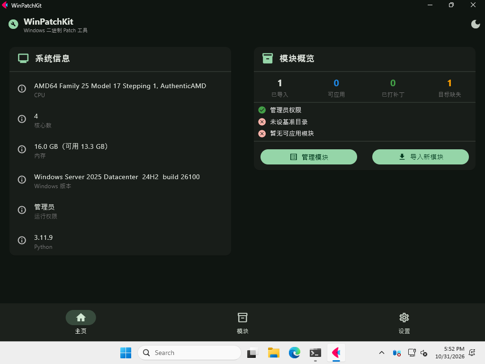

# WinPatchKit

Windows 上的二进制 patch 工具（LSPosed 式"以模块为单位给目标程序打补丁"的初步实现），
纯 Python 实现，**零第三方依赖**。

支持对 PE（.exe / .dll）与裸二进制做锚点、VA、RVA、文件偏移等定位，
并可写入原始字节、NOP 等。架构把"定位"与"写入"做成可插拔策略，
新增一种 patch 方案 = 加一个文件，内核不动。

## GUI 预览

图形界面基于 Flet（深色 Material 3，种子色 `#2E8B57`），共三个页面：

<table>
<tr>
<td align="center">主页<br/></td>
<td align="center">模块<br/></td>
<td align="center">设置<br/></td>
</tr>
</table>

> 以上预览图由 CI 自动渲染并更新（`.github/workflows/ci.yml` 的截图 job），
> 提交改动后会随下一次构建刷新。

**启动 GUI**（引擎本身零依赖，仅 GUI 层需 flet）：

```bash
pip install flet-desktop
python main.py            # 或 python main.py gui
```

## 目录结构

```
WinPatchKit/
  main.py              启动入口（list / import / apply / verify / info / path）
  core/
    pe.py              PE 解析：节区表、VA/RVA/文件偏移互算（纯 Python）
    context.py         策略共享上下文 + 字节/整数解析工具
    spec.py            数据模型：ModuleSpec / PatchSpec（纯数据，含 id/version）
    config.py          TOML 加载（内置 tomllib）+ 目标路径解析
    applier.py         执行器：唯一的写入 / 落盘逻辑
    locators/          定位策略：每种方案一个文件
      base.py          Locator 基类 + 错误类型
      anchor.py        锚点（唯一序列 + delta + sanity 校验）
      va.py            虚拟地址（需 PE）
      rva.py           相对虚拟地址（需 PE）
      file_offset.py   直接文件偏移（PE/裸二进制均可）
    writers/           写入策略：每种方案一个文件
      base.py          Writer 基类
      raw.py           直接写字节
      nop.py           按长度填 0x90
  app/                 应用层（数据目录 / 设置 / 模块导入，依赖 core）
    datadir.py         跨平台数据目录（%APPDATA%/WinPatchKit）
    settings.py        工具设置持久化（settings.json）
    modules.py         模块导入与加载（按模块ID判重）
  examples/            示例配置（工具本体不携带配置，这些仅供参考/手动导入）
    example_demo.toml  配置模板
    oseasy/            从 OsEasy 迁移的 14 个现成模块（见下）
  tests/
    test_winpatchkit.py 端到端测试（动态生成合法 PE，全平台可跑）
```

## 设计要点

**patch = 定位(Where) × 写入(What)**，两个维度正交，各成一组可插拔策略：

- 定位器 `Locator.resolve(ctx) -> int`：只算"写到文件哪个偏移"，不写字节。
- 写入器 `Writer.encode(ctx) -> bytes`：只算"要写哪些字节"，不定位、不落盘。
- 执行器 `applier.run()`：把两者拼起来落盘，是项目里唯一写文件的地方。

**扩展方式**：在 `core/locators/` 或 `core/writers/` 下新建一个 `.py`，
继承对应基类、设 `type` 常量、顶部打 `@register`，再到 `__init__.py` 末尾
`from . import 新文件名` 触发注册即可。`applier.py` 与其他策略文件无需改动。

**裸二进制**：跳过 PE 解析，仅允许 `anchor` / `file_offset` 定位；
在裸二进制上用 `va` / `rva` 会明确报 `NeedPEError`。

## 环境

- Python **3.11+**（依赖内置 `tomllib` 读 TOML）
- 无任何第三方依赖（`pip` 安装为空）

## 快速开始

```bash
# 查看目标 PE 信息（节区 / ImageBase）
python main.py info target.exe

# 列出已加载模块（启动时自动把同级目录 .toml 便捷导入）
python main.py list

# 手动导入配置
python main.py import a.toml b.toml

# 只校验各 patch 能否定位成功，不落盘
python main.py verify <模块id|name|文件名>

# 应用 patch（落盘；备份由设置决定，默认启用，落数据目录/backups/）
python main.py apply <模块id|name|文件名>

# 打印数据目录路径
python main.py path
```

`<module>` 参数支持**模块ID / name / 文件名**三种匹配方式。
目标文件基准目录由 `settings.json` 的 `target_base_dir` 决定，可用 `--base` 临时覆盖。

**备份策略**（由主程序控制，不写进 TOML）：
`apply` 默认启用备份，调用 `applier.run(..., backup=True, backup_dir=数据目录/backups, backup_ext=".bak")`
时对目标做"只备份一次"——动手前检查目标文件名对应的 `.bak` 是否已存在，存在则跳过，
不存在才写入当前（原始）内容。因此重复 apply 不会堆积重复备份，
也不会把已修补的文件误存为"原始备份"。备份统一落在数据目录的 `backups/` 下。

## 数据目录与导入模型

工具本体**不携带任何模块配置**，所有配置集中存放在数据目录：
`%APPDATA%/WinPatchKit`（Windows）或 `~/.config/WinPatchKit`（其它平台）。

```
数据目录/
  settings.json        工具设置（target_base_dir / backup / backup_ext 等）
  configs/             已导入的模块 .toml（工具实际加载的配置都在这里）
  backups/             apply 时对目标文件的一次性 .bak 备份
```

- **手动导入**：`python main.py import a.toml`，把指定 .toml 复制进 `configs/`。
- **便捷导入**：启动时自动扫描工具同级目录（或设置的 `auto_import_dir`）里的
  .toml，搬进 `configs/` 并加载。
- **判重依据是模块ID（`[module].id`）**，与文件名无关：
  手动导入同 id 已存在则覆盖（可换文件名）；便捷导入同 id 已存在则跳过。
- 目标文件基准目录：配置不再与目标同目录，`target` 的相对路径由
  `settings.json` 的 `target_base_dir`（或 `--base`）解析。

`examples/` 目录是仓库自带的**示例配置**（含从 OsEasy 迁移的模块），
仅供参考或手动导入，工具运行时不读取它。

## 配置格式（TOML）

```toml
[module]
id      = "my-module"        # 模块ID（必填）：判断"是否同一配置"的唯一依据
version = "1.0.0"            # 模块版本
name    = "我的模块功能名"    # GUI 展示名（完整中文功能名）
target  = "target.exe"       # 被 patch 的目标（PE 或裸二进制）
out     = ""                 # 空 = 就地写 target

[[module.patches]]
id    = "fix_call"
where = { type = "anchor", pattern = "48 8B 05 11 22 33 00", which = 1, delta = 0 }
write = { type = "raw", bytes = "48 8B 0D 11 22 33 00" }
```

- `id`（**必填**）：模块的唯一身份标识。手动导入 / 便捷导入时按 `id` 判重：
  同 `id` 已存在则手动导入覆盖、便捷导入跳过。文件名与 `id` 无关。
- `version`：模块版本，供后续云端更新/冲突检测使用。
- `where` / `write` 是内联表，`type` 字段即策略名，其余键为该策略参数。

## 测试

```bash
python tests/test_winpatchkit.py
```

不依赖真实 Windows exe，在测试里动态构造一个合法 PE32+ 文件，
覆盖 PE 解析、四种定位、两种写入、裸二进制路径、锚点不唯一、
VA 用于裸二进制报错、verify 不落盘等场景。

## 已迁移模块（examples/oseasy/）

从 `OsEasy/OsEasyPatchTool.py` 的 `SOLUTIONS` / `MMPC_FILE` / `EXTRA_TARGETS`
抽出全部**文件 patch**，每个 patch 拆成一个独立模块（一个 toml），
现作为示例配置放在 `examples/oseasy/`（手动导入或云端下发后加载）。
每个模块的 `id` 采用其英文文件名，`version` 为 `1.0.0`。

| 文件 | name（GUI 展示名） | 目标 | 定位 |
|------|------|------|------|
| remove-connect-limit.toml | 移除学生机连接数限制 | MainLogic.dll | anchor+delta6 |
| remove-nodog-startup-dialog.toml | 消除"未找到加密狗"启动弹窗 | Teacher.exe | anchor |
| student-exit-password-bypass.toml | 学生端退出密码恒通过 | Student.exe | anchor |
| disable-behavior-control-mmpc.toml | 禁用行为管控（MMPC 服务，需停服务） | MMPC.exe | anchor(14B) |
| disable-behavior-control-multiclient.toml | 禁用行为管控（MultiClient） | MultiClient.exe | file_offset |
| disable-screen-broadcast-multiclient.toml | 禁用屏幕广播（MultiClient） | MultiClient.exe | anchor |
| screen-broadcast-windowed-screenrender.toml | 屏幕广播窗口化（ScreenRender） | ScreenRender.exe | anchor |
| screen-broadcast-force-windowed.toml | 屏幕广播统一窗口化（MultiClient） | MultiClient.exe | anchor |
| fullscreen-broadcast-real-desktop.toml | 全屏广播切换真实桌面（MultiClient） | MultiClient.exe | anchor |
| disable-keyboard-mouse-lock.toml | 屏幕广播不锁键鼠（MultiClient） | MultiClient.exe | anchor |
| dual-launch-teacher.toml | 双开教师端/学生端（Teacher） | Teacher.exe | anchor+sanity |
| dual-launch-student.toml | 双开教师端/学生端（Student） | Student.exe | anchor+sanity |
| block-remote-shutdown-restart.toml | 拦截远程关机/重启（Student） | Student.exe | anchor |
| stop-screenshot-upload.toml | 停止截屏发送（StudentLogic） | StudentLogic.dll | anchor |

**为承载这些模块，框架较 MVP 增强的两点**（均保持"执行/配置分离"）：

- `anchor` 定位器新增 `unique`（默认 true，要求锚点恰好出现 1 次，抗误命中）
  与 `sanity_window`/`sanity_pattern`（命中处附近窗口须含特征字节，如 `ff15`）。
- 执行器新增 `expect`（写前校验当前字节==期望原始字节；已是目标态则幂等跳过，
  兼容 new 比 orig 短的等长/不等长改动）。

**未迁移（留待后期）**：

- `screencap_fake`（假截图）：需把整段函数体替换为 shellcode，依赖后期
  `shellcode` 写入器，暂不迁移。
- 内存 patch（`MEM_PATCHES`）：需运行时进程内存读写（OpenProcess/WriteProcessMemory），
  属 WinPatchKit 后续"运行时 hook"能力，不在文件 patch 范围。

## 路线（后期扩展，架构已预留）

- 写入策略：`jmp`（detour 砖块）、`mov_ptr`、`bytes_expr`
- 定位策略：`import`（IAT 槽定位）、`section`（按节名+偏移）
- 功能：函数 hook / code cave、模块注入